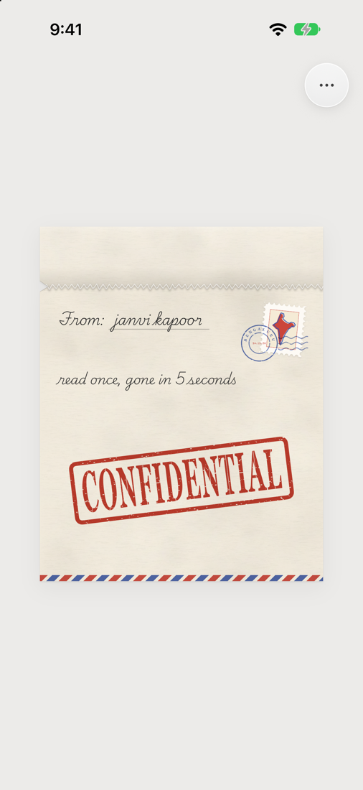
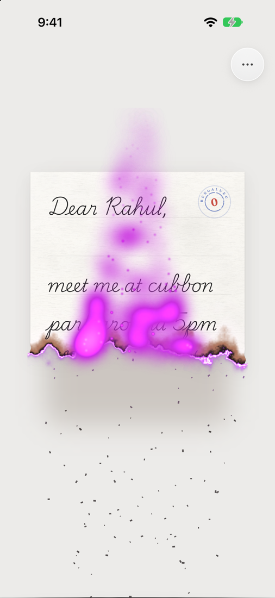
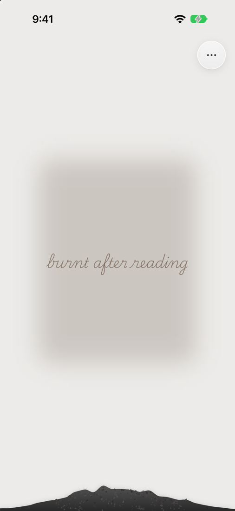

# Burn After Reading

A small SwiftUI interaction experiment: tear open a confidential letter, read it before the postmark runs out, then watch it burn away.

  
  
  

## Run it

iOS 17+, iPhone or iPad, no dependencies. Open `Stardust.xcodeproj`, pick the **Stardust** scheme and a simulator, and run. For a device, set your team under Signing & Capabilities.

## How it works

- **Tear.** Drag right across the flap. The strip curls up and follows your finger along a perforated edge; let go past 85% (or flick) and it rips off with a haptic thud.
- **Read.** The letter's postmark is the timer: its ring inks away while the seconds count down.
- **Burn.** A Metal shader scorches, chars and eats the card from the bottom up with a purple ember rim, while a particle swirl rises from the burn line.
- **Ash.** Flakes fall into a heap at the bottom of the screen, and "burnt after reading" is left where the letter was. Tap the heap to blow the ash away and get a fresh envelope.

Settings (the ••• button) control how long the letter stays readable (3–8 s) and how long the burn lasts (2–7 s). Reduce Motion swaps the motion for gentle fades, and VoiceOver can reveal and read the letter.

## Code

| File | What it does |
| --- | --- |
| `ContentView.swift` | The reveal → read → burn → reset sequence, the letter, and settings |
| `Effects/PaperTearRevealCover.swift` | The envelope, the tear gesture and the paper curl |
| `Effects/CardFadeEffect.swift`, `Effects/Burn.metal` | The burn front and the shader that draws it |
| `Effects/ParticleCanvasView.swift` | The rising particle swirl |
| `Effects/AshFallView.swift` | Falling ash and the heap |
| `Effects/PostalMarks.swift` | Stamp and postmark artwork |

## Credits

- The burning particle swirl is based on [Particle effects with SwiftUI Canvas](https://nerdyak.tech/development/2024/06/27/particle-effects-with-SwiftUI-Canvas.html) on nerdyak.tech.
- Handwriting is [Playwrite US Trad](https://fonts.google.com/specimen/Playwrite+US+Trad), under the SIL Open Font License (`Stardust/Fonts/OFL.txt`).
